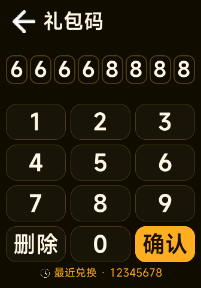
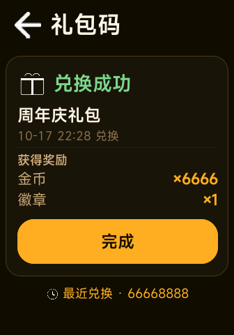
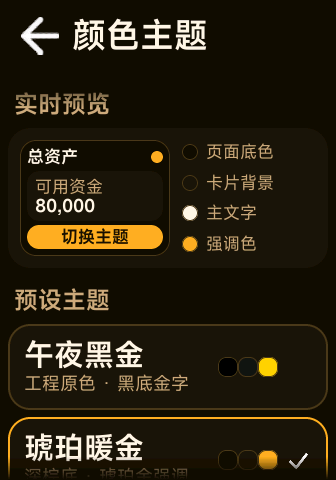
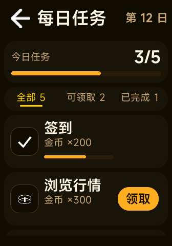
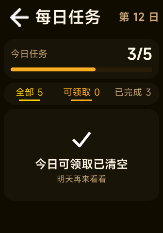

# 题 2 · 改版：静态壳 + 三块新功能

基于蓝桥工作室 starter（`com.bluebridge.review`，336 × 480 手环快应用）完成的改版题提交。
保留原有 7 个页面与视觉语言，在设置页新增三个入口：**礼包码**、**颜色主题**、**每日任务**。

- 包名：`com.bluebridge.review`
- 版本：`0.2.0`（versionCode `2`）
- 设计基准：`designWidth: 336`，336 × 480，minAPILevel 2
- 构建产物：`dist/com.bluebridge.review.debug.0.2.0.rpk`（提交包内为 `vela-task2-review.debug.0.2.0.rpk`，同一产物）

## 截图

| 礼包码 · 自绘键盘 | 兑换成功 |
| --- | --- |
|  |  |

| 颜色主题 | 每日任务 | 可领取空状态 |
| --- | --- | --- |
|  |  |  |

## 一、构建与运行

环境要求：Node.js ≥ 20，npm（依赖已固定 `aiot-toolkit ^2.0.5`）。

```bash
npm install
npm run build          # 清理旧包 → aiot-toolkit build → 打印 rpk 路径与体积
```

产物在 `dist/com.bluebridge.review.debug.0.2.0.rpk`（development 模式 + 工具链内置开发签名）。

安装到 Vela 模拟器 / 真机（示例为官方 VVD + adb）：

```bash
adb push dist/com.bluebridge.review.debug.0.2.0.rpk /data/local/tmp/app.rpk
adb shell pm install /data/local/tmp/app.rpk     # 不要加 -r，Vela 5.0 会报 -38
adb reboot && adb shell am start com.bluebridge.review
```

> 本仓库的模拟器验证使用官方 Vela 5.0 虚拟设备（336 × 480）、gRPC 截图与鼠标事件注入回放；
> 截图见 `screenshots/`。

## 二、三块功能

### 1. 礼包码（设置 → 礼包码）

**入口**：设置页「礼包码」。整页自绘，无 `input` 组件、不唤起系统输入法。

**自绘键盘**
- 数据驱动 3 列 × 4 行：1–9 / 删除 / 0 / 确认，键 100 × 60、间距 8，整块 316 宽居中；
- 按键按下/点击时：短振动（`vibrator.vibrate({mode:'short'})`，try/catch 兜底）+ 缩放动画 + 底色切换到强调色；
- 输入显示为 8 个码位格（36 × 48），当前待输入格用强调描边高亮，已输入数字 34px；
- 「删除」短按删一位；**长按 450ms 后每 80ms 连续删除**：`ontouchstart` 启定时器，
  `ontouchend/ontouchcancel` 清理，并用标记抑制随后触发的 `click`，避免长按后多删；
- 防连点：确认后 800ms 内忽略重复提交（`busy` 标志 + 定时器，`onHide` 时复位）。

**流程与反馈**
- 提交校验：长度不足 / 无效码 → 红色提示 + 码位行 `translateX` 抖动（`@keyframes`，显式 0%/100%）；
- 重复兑换 → 黄色提示「该礼包码已兑换过」；
- 成功 → 奖励卡（礼包名、兑换时间、奖励列表、完成按钮），并写入已兑换列表与最近兑换；
- 键盘下方显示「最近兑换 · 码」，无记录时显示「暂无兑换记录」。

**有效礼包码（8 位）**

| 礼包码 | 礼包 | 奖励 |
| --- | --- | --- |
| `20261017` | 蓝桥迎新礼包 | 金币 ×5000、体验券 ×1 |
| `88888888` | 股市大亨礼包 | 金币 ×8888 |
| `12345678` | 测试礼包 | 金币 ×1000 |
| `66668888` | 周年庆礼包 | 金币 ×6666、徽章 ×1 |
| `13145200` | 幸运礼包 | 金币 ×520 |

**6 位现场改造**：礼包码页顶部常量 `CODE_LEN = 8` 改为 `6` 即可：
码位格数量、提示、校验长度自动切到 6 位，并启用预置的 6 位码表
`888888 / 520520 / 123456`（`EXTRA_6_CODES`）。整个改动只动一个常量。

**存储**（`@system.storage`，均为带版本号的 JSON，解析失败自动回落到空数据，不崩溃）：
- `bb_gift_redeemed_v1` = `{"v":1,"codes":["20261017", ...]}`
- `bb_gift_last_v1` = `{"v":1,"code":"88888888","timeText":"10-17 22:04"}`

### 2. 颜色主题（设置 → 颜色主题）

**5 套琥珀金深色主题**（全部深色底 + 金色系强调，和工程原色同一气质）：
午夜黑金（默认）、琥珀暖金、青铜古金、香槟暖金、落日暖橙；另有 6 个强调色色板与「默认（跟随主题）」。

**为什么用「令牌 + 内联样式绑定」接入样式体系**
Vela 快应用不支持 CSS 变量，也不支持后代选择器（仅 .class / #id / tag / 并列）。
因此不能写 `.theme-amber .title { color: ... }`。工程的做法是：

1. `src/common/theme.js` 定义主题令牌（bg / surface / text / sub / muted / accent / border / line / key / keyText / success / danger …）；
2. 页面把令牌对象绑定到内联样式：`<text class="top-title" style="{{t.text}}">`，
   布局仍由 `common/theme.css` 与页面 `<style>` 的 class 负责，内联样式优先级更高；
3. 所有页面（含既有 7 页）的 `onInit/onShow` 调 `applyTheme(this)`：先按缓存同步渲染避免闪白，
   再从 storage 强制重读一次，保证**在主题页切换后返回任意页面都即时变色**；
4. 图标有 `/common/icons/w`（白描边）与 `/common/icons/d`（深描边）两套，按主题背景亮度自动切换
   （当前主题均为深色，实际使用白描边；浅色主题预留了完整能力）。

**持久化**：`bb_theme_v1` = `{"v":1,"themeId":"amber","accent":""}`
- `themeId` 必须存在于 `THEMES`；未知值回落到默认主题；
- `accent` 为空串表示使用主题自带强调色，否则覆盖强调色；
- `normalizeState` 保留未知字段，将来加字段时旧数据可直接升级（现场追问点）。

**可读性**：主题页用 WCAG 2.1 公式实时计算「正文/背景」「强调/背景」对比度与等级（优秀/良好/勉强/不足），
低于 3:1 时用危险色提示；当前 5 套主题正文对比度均 ≥ 7:1。

**恢复默认**：主题页底部按钮 → `resetTheme()`，同时清空强调色，Toast 提示。

### 3. 每日任务（设置 → 每日任务）

只做 UI 与交互，数据为静态种子（`TASK_SEED`），不接真实任务系统。

- 顶部进度卡：今日进度 `3/5`（大号数字）+ 进度条 + 「待领取 2/5」；
  **进度口径统一为「已完成任务数 = 已领取 + 可领取」，进行中任务不计入**，
  避免出现「顶部 5/5、列表还有 3/5 进行中」这种自相矛盾；
- 状态 Tab：全部 / 可领取 / 已完成，带数量；选中态为强调色文字 + 3px 指示条；
- 列表项：任务图标、标题、奖励、进行中任务的进度条 + 数字、右侧「领取」按钮 / 「已领取」标签；
- 领取：600ms 防连点 + 按钮脉冲/行高亮动画 + 振动 + Toast「已领取 金币 ×300」，
  随即状态转已领取、计数与进度条更新；
- 空状态：可领取任务全部领完后，「可领取」Tab 显示空状态卡（对勾图标 +「今日可领取已清空」+「明天再来看看」）；
- 状态覆盖：进行中（含进度条）、可领取（按钮）、已领取（标签）、空状态。

## 三、主题令牌速查

| 令牌 | 含义 |
| --- | --- |
| `t.page` / `t.topbar` | 页面 / 顶栏背景 |
| `t.card` / `t.cardAlt` / `t.tile` | 卡片 / 更亮一档卡片 / 列表项底 |
| `t.text` / `t.sub` / `t.muted` | 主文字 / 次要文字 / 弱化文字 |
| `t.accent` / `t.accentBg` / `t.onAccent` / `t.accentBorder` | 强调文字、强调底、强调底上的文字、强调描边 |
| `t.border` / `t.line` | 描边 / 分割线 |
| `t.key` / `t.keyText` | 自绘键盘按键底 / 字 |
| `t.success` / `t.danger` / `t.warning` | 语义色 |
| `t.iconBack` 等 `icon*` | 跟随明暗主题的图标路径 |

## 四、工程结构（相对 starter 的变化）

```text
src/
├── common/
│   ├── theme.js              # 新增：主题令牌 / 读写 / 对比度 / 图标路径
│   ├── theme.css             # 扩展：新增功能共用骨架（.screen-body/.card/.tag/.progress-* 等）
│   └── icons/w|d/            # 新增：明暗两套图标 + 礼包/调色板/清单等新图标
├── pages/
│   ├── gift/gift.ux          # 新增：礼包码 + 自绘键盘
│   ├── theme/theme.ux        # 新增：颜色主题
│   ├── tasks/tasks.ux        # 新增：每日任务
│   ├── settings/settings.ux  # 修改：三个入口 + 主题接入
│   ├── splash|home|market|portfolio|stock-detail|about/*.ux  # 主题接入（布局零改动）
└── manifest.json             # 新增 3 条路由；版本 0.2.0（2）
```

**回归**：既有 6 页只增加 `style/src` 绑定与主题生命周期接管，未改任何尺寸、字号与交互；
默认主题下与原工程视觉一致（截图见上方「每日任务」「颜色主题」页的顶栏与卡片）。

## 五、现场改动预案

| 现场要求 | 改法（1 处 / 几处） |
| --- | --- |
| 礼包码改成 6 位 | `gift.ux` 的 `CODE_LEN` 8 → 6（码位/校验/6 位码表自动切换） |
| 长按连续删除 | 已实现：删除键 450ms 后每 80ms 删一位 |
| 主题切换后杀进程重启验证持久化 | `bb_theme_v1` 存储，重启后 `onInit` 读取并生效 |
| 插入「已完成未领取」数据 | `TASK_SEED` 里加一条 `state:"claimable"`，counts/进度/tab 自动重算 |
| 礼包码页加「最近一次兑换码」 | 已有：键盘下方「最近兑换 · 码」（`bb_gift_last_v1`） |
| 颜色转换加一键恢复默认 | 已有：主题页底部「恢复默认主题」 |

## 六、AI 使用说明（如实记录）

- **工具链**：DeepSeek Harness（DSH）Agent Teams。Lead 负责主题体系、路由、设置页、构建与模拟器验证；
  4 个子代理并行实现三块功能与既有页主题化：
  - `gift-keypad`：礼包码页与自绘键盘；
  - `theme-page`：颜色主题页；
  - `tasks-page`：每日任务页；
  - `retrofit-pages`：既有 6 页主题接入。
- 子代理的约束写在 `docs/THEME.md`（主题令牌、Vela 限制、写文件边界、禁止并行构建），
  所有产物由 Lead 统一构建、安装到官方 Vela 模拟器、逐屏截图验证。
- **AI 生成的范围**：页面模板/样式、交互脚本、主题令牌表、图标绘制脚本、README 初稿；
  **人工（Lead）审查与修正**的关键点：
  1. 键盘最初在 `touchstart` 里重建键位数组，导致节点被替换、`touchend/click` 丢失，按键卡在按下态 → 改为 click 后高亮；
  2. 主题从主题页返回设置/首页不刷新（页面级缓存）→ 增加 `refreshTheme` 强制重读 storage；
  3. 任务列表行 `flex:1` 在 Vela 下塌陷 → 改为显式宽度栅格；
  4. 任务进度口径与列表「3/5」自相矛盾 → 统一为「已完成 = 已领取 + 可领取」；
  5. 删除「已输入 n/8」「还差 n 位」「清空」等无效占位元素，放大键盘/数字/图标（手环实机观感偏小）。
- **验证方法**：`aiot-toolkit` 构建 → adb 安装重启 → 官方模拟器 gRPC 截图；
  触摸注入实测 sendTouch 无效，改用 sendMouse 按下/移动/抬起序列回放，逐条点按验证。

## 七、迭代日志

1. **v0.1 基底与主题架构**：跑通 starter 构建；确定「令牌 + 内联样式」主题方案（Vela 无 CSS 变量/后代选择器），
   新增 `theme.js`、5 套琥珀金深色主题、明暗两套图标，既有 6 页完成主题接入，默认主题下无回归。
2. **v0.2 三块功能并行**：礼包码（自绘 3×4 键盘、长按连删、成功/失败/重复码、存储）、
   颜色主题（预设/强调色/对比度/恢复默认/持久化）、每日任务（进度/状态 tab/领取动画/空状态）全部落地。
3. **v0.3 模拟器联调**：修复按键点击丢失、主题返回不刷新、任务行塌陷、进度口径矛盾；
   加宽/放大键盘与数字，统一琥珀金深色视觉，删除无效占位元素。
4. **v0.4 验收**：逐屏截图核对五套主题切换、礼包码兑换、任务领取与空状态；构建产物校验包名/版本/designWidth。
5. **v0.5 打磨与去噪**：滚动内容与顶栏之间改为「半透明图片遮罩」渐隐（按主题背景色生成 336×36 / 336×24 PNG，
   每个页面仅 1 张静态图叠加，无动画/无每帧计算，手环性能无压力；切主题自动换对应色罩，不会出现黑边硬切）；
   同时删除「已输入 n/8」「还差 n 位」「清空」「待领取 x/5」「暂无兑换记录」「恢复为午夜黑金…」等冗余元素，
   任务页进度卡压缩为一行「今日任务 3/5 + 进度条」，数字与图形进度、tab 计数全部对齐。

## 八、已知限制

- 主题页的对比度是本地计算，未针对色弱模式做专门适配；
- 滚动渐隐遮罩按 5 套主题各生成一对小尺寸 PNG（合计约 8 KB），换取零运行时开销与无黑边观感；
- 每日任务为纯静态演示数据，不持久化领取状态（题面只要求 UI）；
- 键盘为数字九宫格，礼包码限定数字（题面要求 0–9 + 删除 + 确认）。